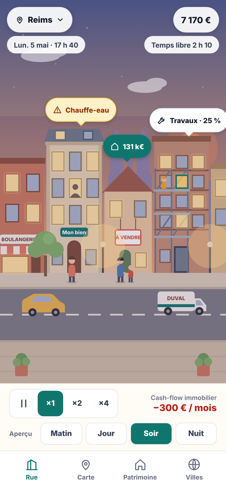
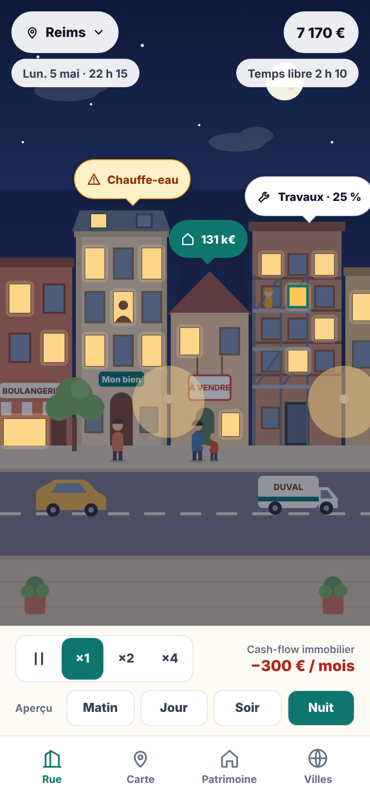
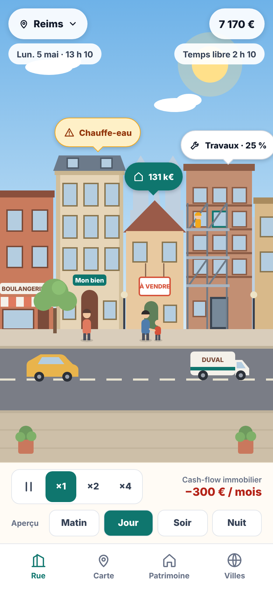
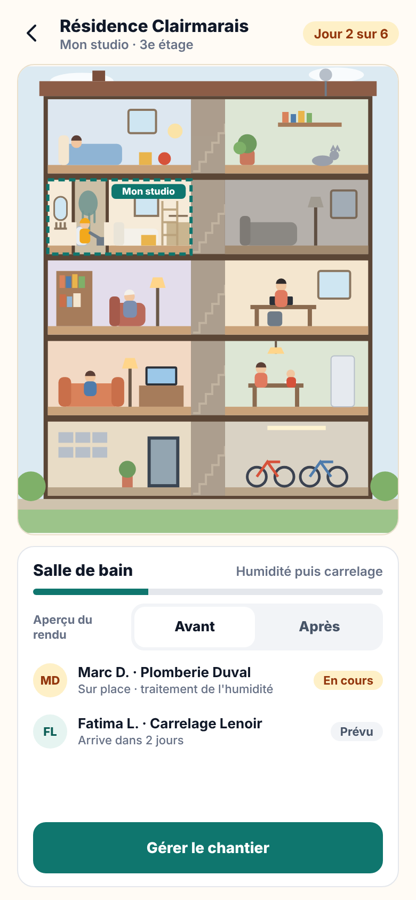
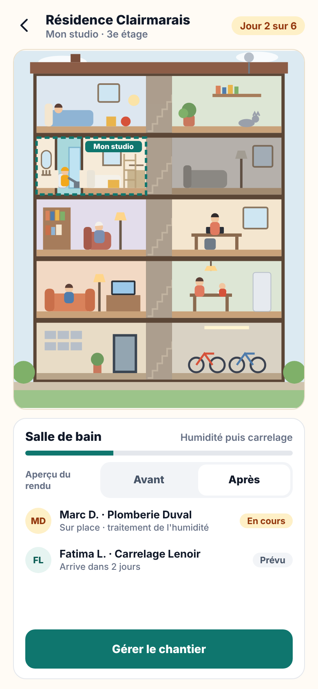
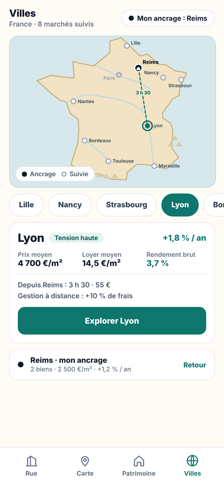
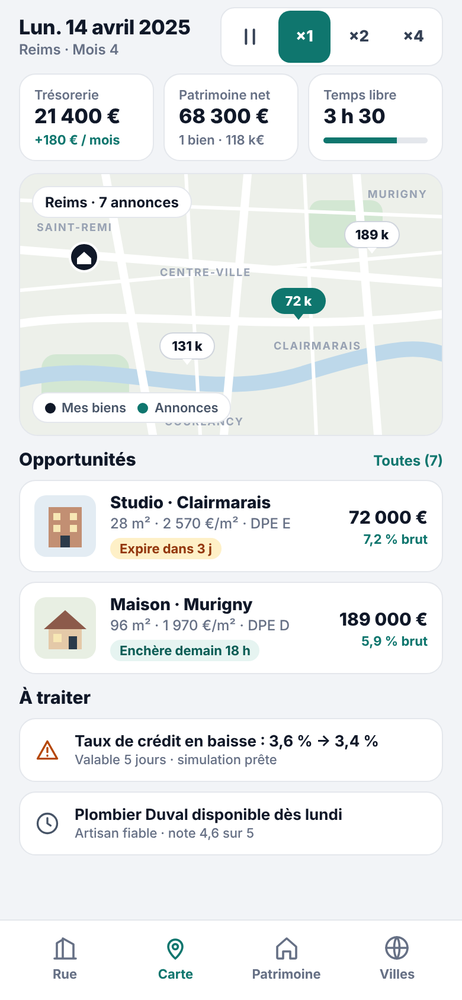
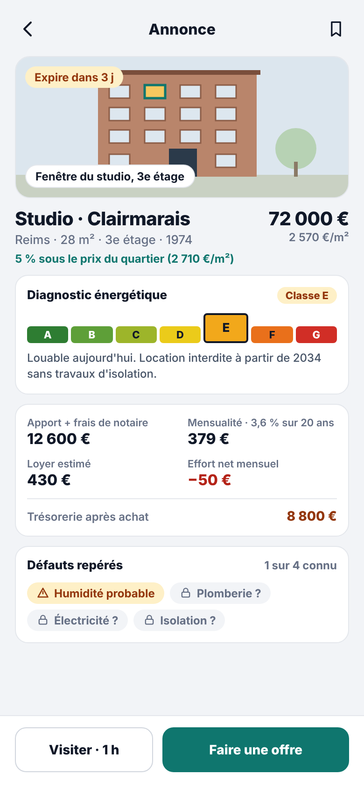
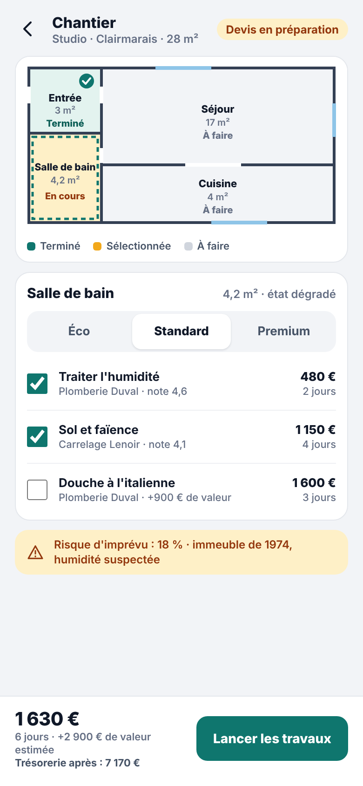
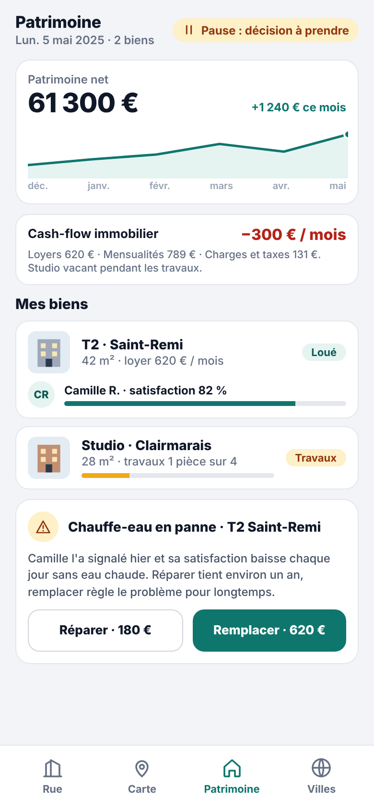

# Maquettes préliminaires

> **Important : ces maquettes sont préliminaires.**
> Elles ont été réalisées **avant** la conception détaillée, pour explorer l'ambiance et l'organisation des écrans. Elles donnent une **intention**, pas une spécification.
>
> - Les écrans **peuvent et doivent être revus et améliorés** pendant la réalisation, pour rendre le jeu meilleur.
> - Le graphisme est à améliorer (voir [05-direction-artistique.md](../05-direction-artistique.md)).
> - **Les chiffres sont illustratifs.**
> - Elles datent d'avant le choix de **Dole** comme ville de départ : elles montrent **Reims** et une carte de France avec d'autres villes. La conception retenue est décrite dans [03-systemes/08-villes-et-deplacements.md](../03-systemes/08-villes-et-deplacements.md).
> - La navigation affichée (4 onglets) diffère de celle retenue (5 onglets : Rue, Carte, Décisions, Patrimoine, Menu), voir [04-interface.md](../04-interface.md).
>
> En cas de différence, **la documentation fait foi**.

## Écrans de jeu (style illustré)

| Rue vivante, soir | Rue vivante, nuit | Rue vivante, jour |
|---|---|---|
|  |  |  |

| Coupe d'immeuble, avant travaux | Coupe d'immeuble, après travaux | Les autres villes |
|---|---|---|
|  |  |  |

## Écrans de gestion (style sobre)

| Carte et opportunités | Fiche d'une annonce | Chantier pièce par pièce | Patrimoine et vie |
|---|---|---|---|
|  |  |  |  |

## Sources

Le dossier [`sources/`](sources/) contient les fichiers d'origine des maquettes (`.dc.html`). Ils sont au format de l'outil de maquettage utilisé et **ne s'ouvrent pas tels quels** dans un navigateur ; ils servent de référence (couleurs, dispositions, textes). Les images ci-dessus en sont des captures en 390 × 844 px.
